<div align="center">

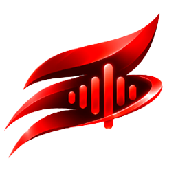

# Veyro

### Твой звук. Твои правила.

Микшер громкости для Windows, который хочется оставить под рукой.<br>
Отдельная громкость приложений, умные группы и интерфейс в твоём стиле.

**Windows 10 / 11 · x64 · Приложение в трее**

[Быстрый старт](#быстрый-старт) · [Возможности](#возможности) · [Темы](#темы) · [Размеры](#три-размера-интерфейса)

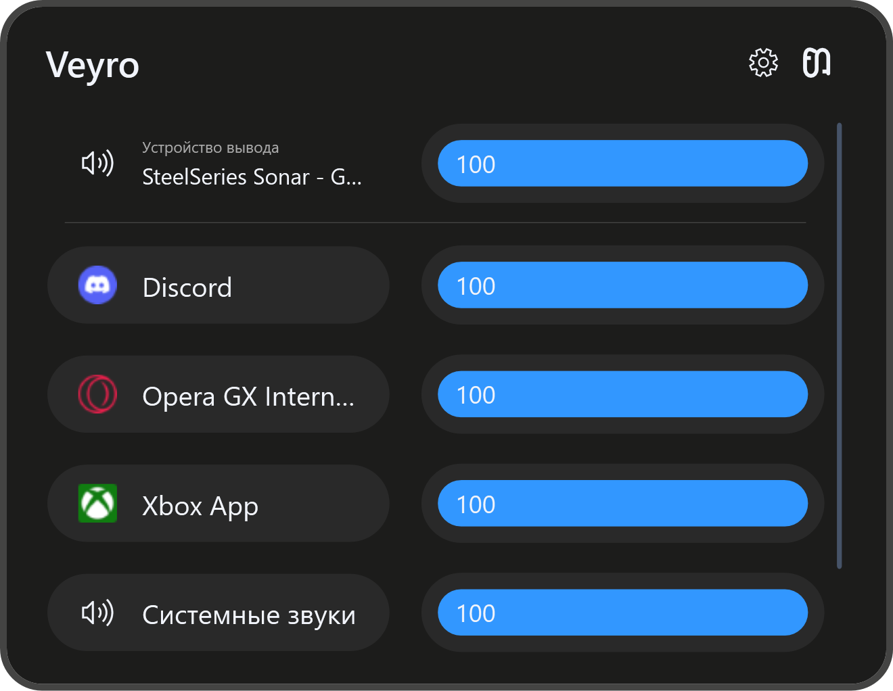

**Музыку — тише. Разговор — громче. Всё остальное — под контролем.**

</div>

---

## Быстрый старт

1. Запусти **Veyro.exe** из этой папки.
2. Нажми на значок Veyro в области уведомлений Windows. Если значка не видно, открой скрытые значки рядом с часами.
3. Начни воспроизведение в нужном приложении и настрой его громкость ползунком.
4. Открой настройки через шестерёнку: выбери тему, размер интерфейса и режим сортировки.

Чтобы завершить работу, нажми правой кнопкой мыши на значок Veyro в трее и выбери **«Выход»**.

> Здесь находится само приложение. Автозапуск при входе в Windows можно выбрать при установке через отдельный установщик Veyro.

## Возможности

| | Что умеет Veyro |
| :--- | :--- |
| **Громкость приложений** | Отдельный уровень для музыки, браузера, игр и голосового общения. |
| **Устройство вывода** | Быстрое переключение устройства воспроизведения из главного окна. |
| **Умные группы** | Объединение приложений по категориям и регулировка громкости группы. Автосортировку можно отключить. |
| **Ручной порядок** | Собственные папки, распределение приложений и перестановка строк перетаскиванием. |
| **Персонализация** | Четыре готовые темы и собственная палитра с предпросмотром. |
| **Три размера** | Компактный, обычный и крупный интерфейс. |
| **Быстрый доступ** | Микшер открывается из трея, настройки сохраняются автоматически. |

## Звук без лишних действий

<table>
<tr>
<td width="50%" align="center">
<h3>Выбери, где слушать</h3>
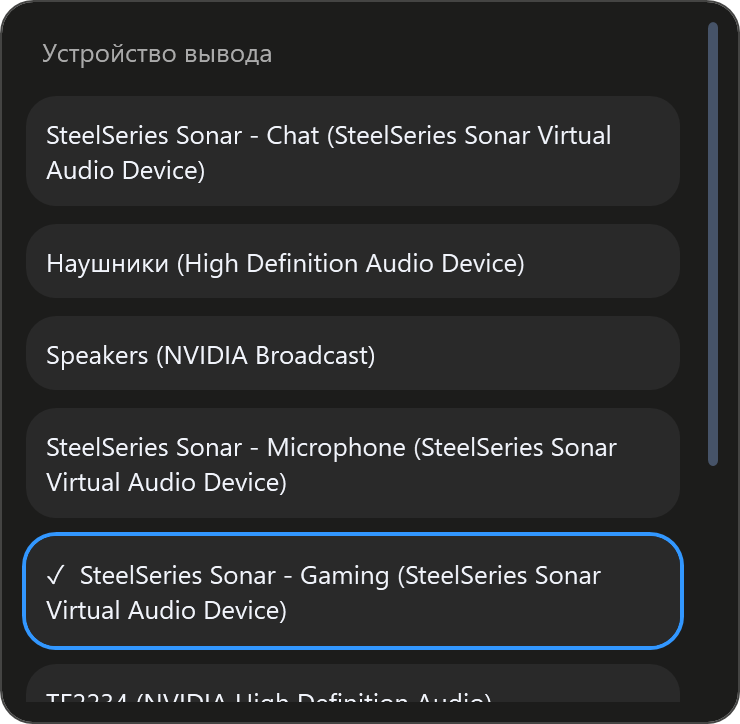
<p>Устройства воспроизведения и отметка текущего выбора в одном меню.</p>
</td>
<td width="50%" align="center">
<h3>Управляй целой группой</h3>
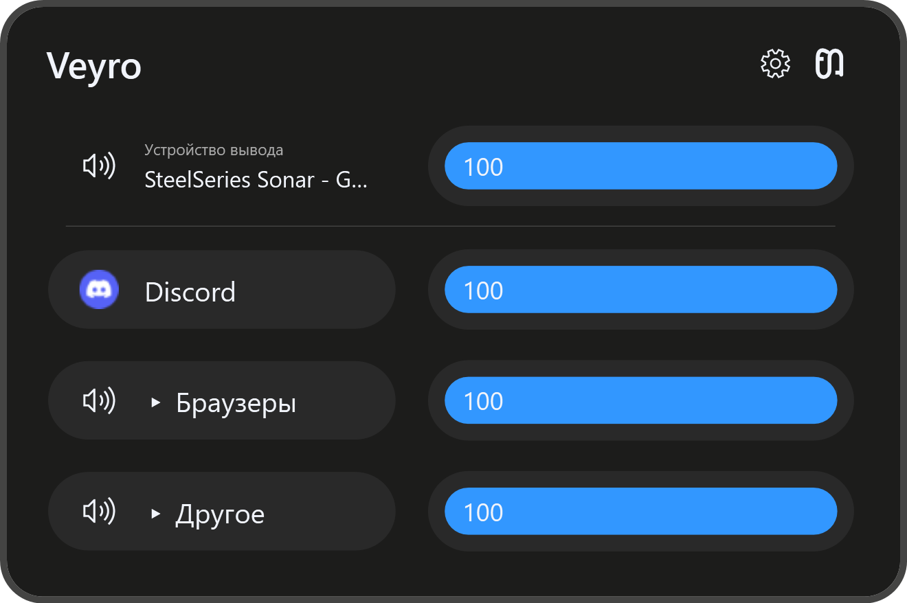
<p>Общая громкость для приложений одной категории.</p>
</td>
</tr>
<tr>
<td width="50%" align="center">
<h3>Открой детали</h3>
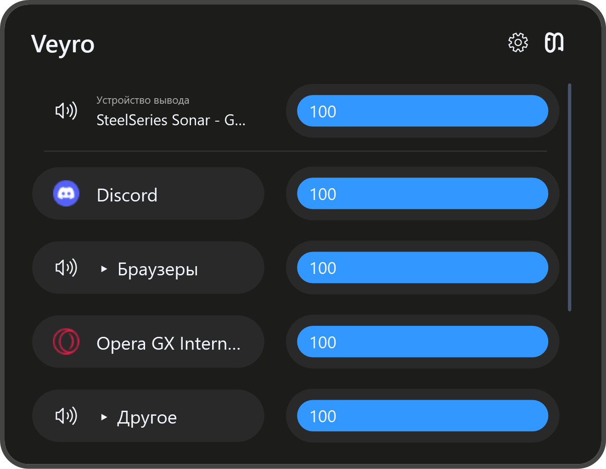
<p>Раскрой группу и настрой каждое приложение отдельно.</p>
</td>
<td width="50%" align="center">
<h3>Наведи свой порядок</h3>
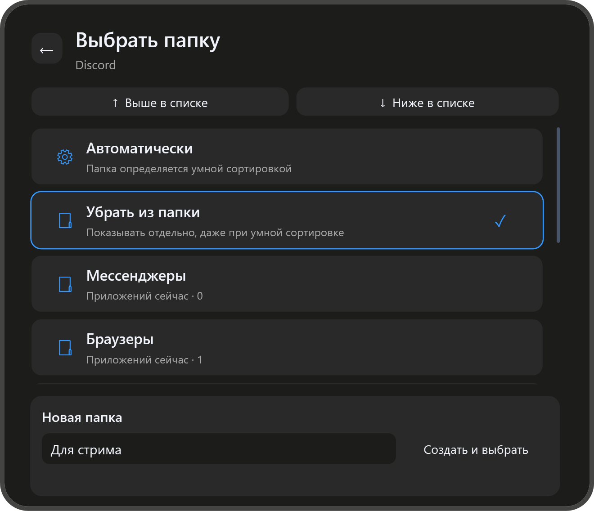
<p>Выбери папку или создай свою под привычный сценарий.</p>
</td>
</tr>
</table>

## Темы

Четыре настроения для твоего рабочего стола. Меняй оформление в настройках — от спокойного тёмного до светлого или цветного.

<table>
<tr>
<td width="50%" align="center"><h3>Графит</h3><p>Тёмная основа и синий акцент.</p></td>
<td width="50%" align="center"><h3>Жемчуг</h3><p>Светлый и мягкий интерфейс.</p>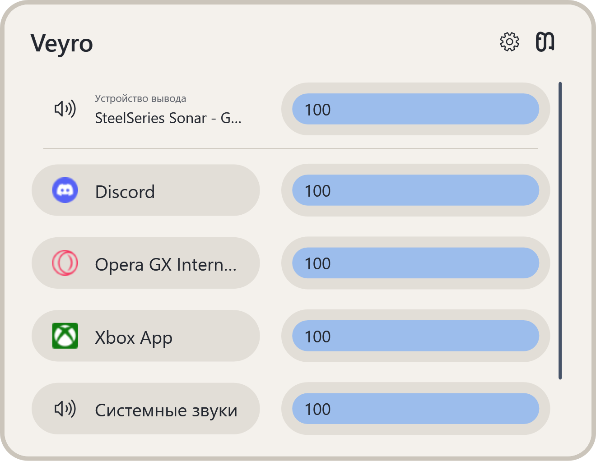</td>
</tr>
<tr>
<td width="50%" align="center"><h3>Ирис</h3><p>Глубокие оттенки с фиолетовым акцентом.</p>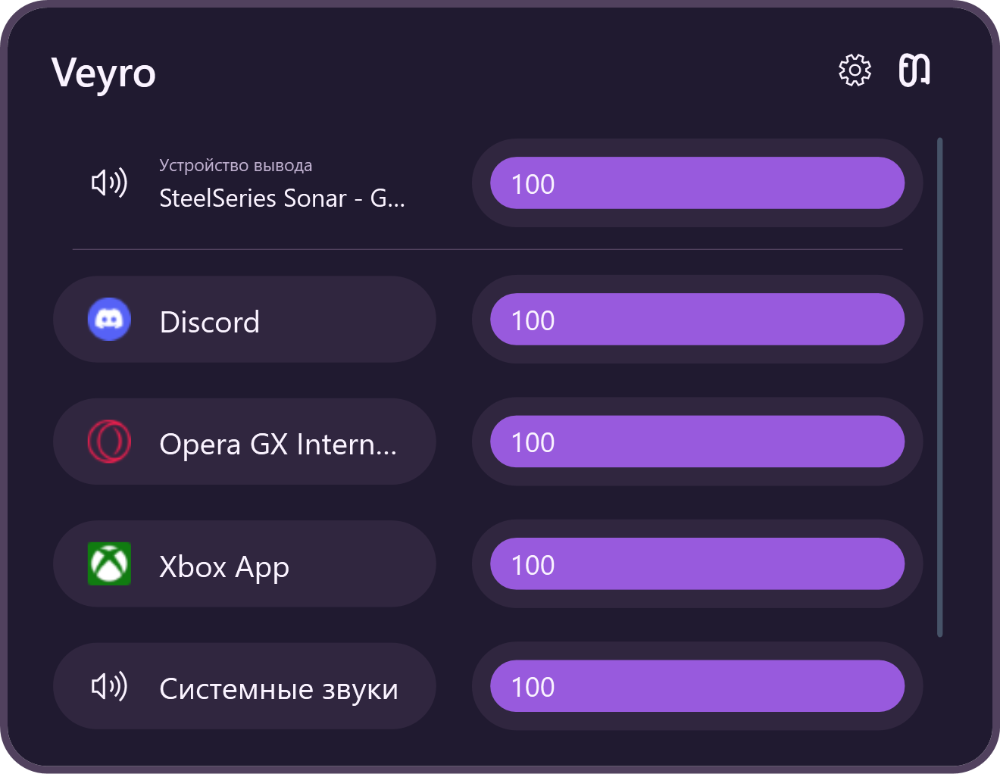</td>
<td width="50%" align="center"><h3>Хвоя</h3><p>Спокойная зелёная палитра.</p>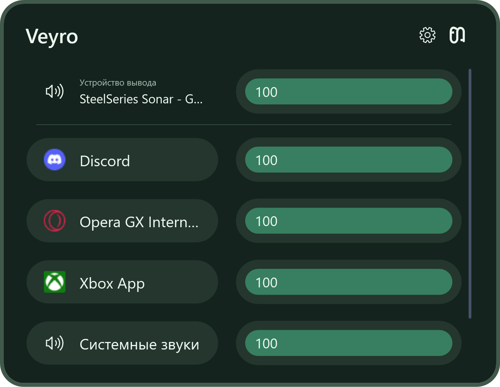</td>
</tr>
</table>

### Твоя собственная палитра

Студия темы открывается отдельным окном: меняй цвета и сразу смотри, как выглядит микшер. Настрой фон, поверхности, текст, обводку и акцент под себя.

<table>
<tr>
<td width="50%" align="center">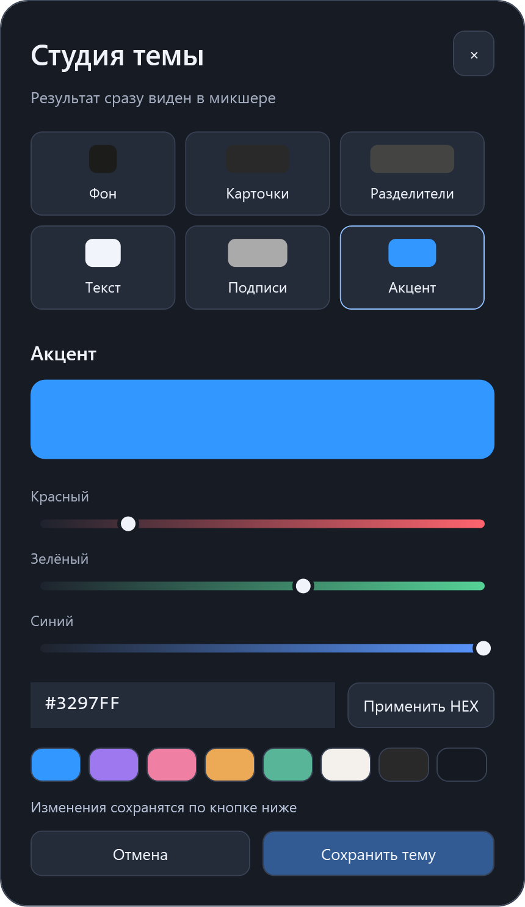<p><b>Настрой цвета</b></p></td>
<td width="50%" align="center">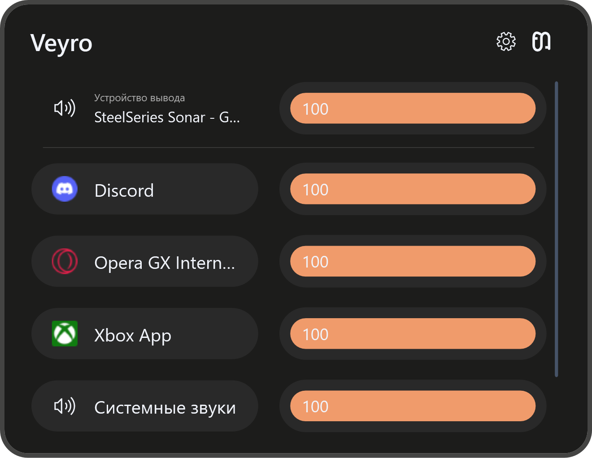<p><b>Посмотри результат</b></p></td>
</tr>
</table>

## Три размера интерфейса

Один набор возможностей — три масштаба. Выбери удобный в настройках.

| Компактный | Обычный | Крупный |
| :--- | :--- | :--- |
| **460** логических px | **560** логических px | **660** логических px |
| Больше места для других окон. | Баланс размера и удобства. | Крупные подписи и элементы управления. |

<details>
<summary><b>Посмотреть все три размера</b></summary>

<p>Изображения ниже показаны в пропорциях 460 : 560 : 660. На узком экране просмотрщик README может уменьшать их до ширины страницы. Фактический размер окна зависит также от масштабирования Windows.</p>

<h4>Компактный</h4>
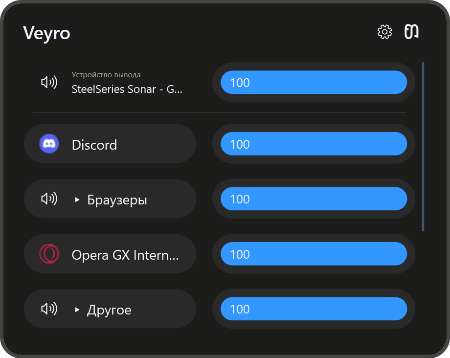

<h4>Обычный</h4>
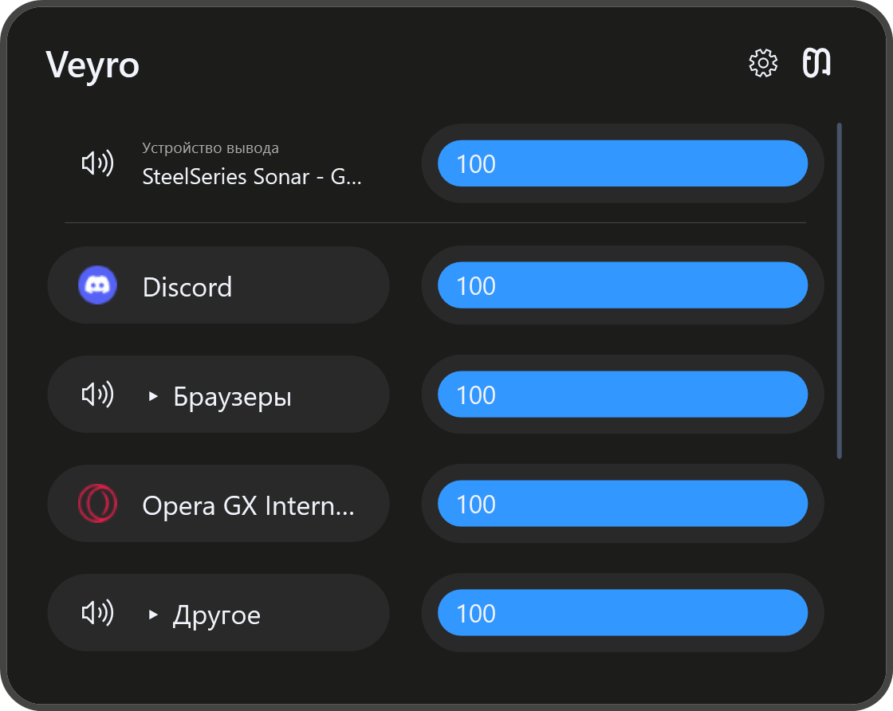

<h4>Крупный</h4>


</details>

## Всё важное — в настройках

<div align="center">
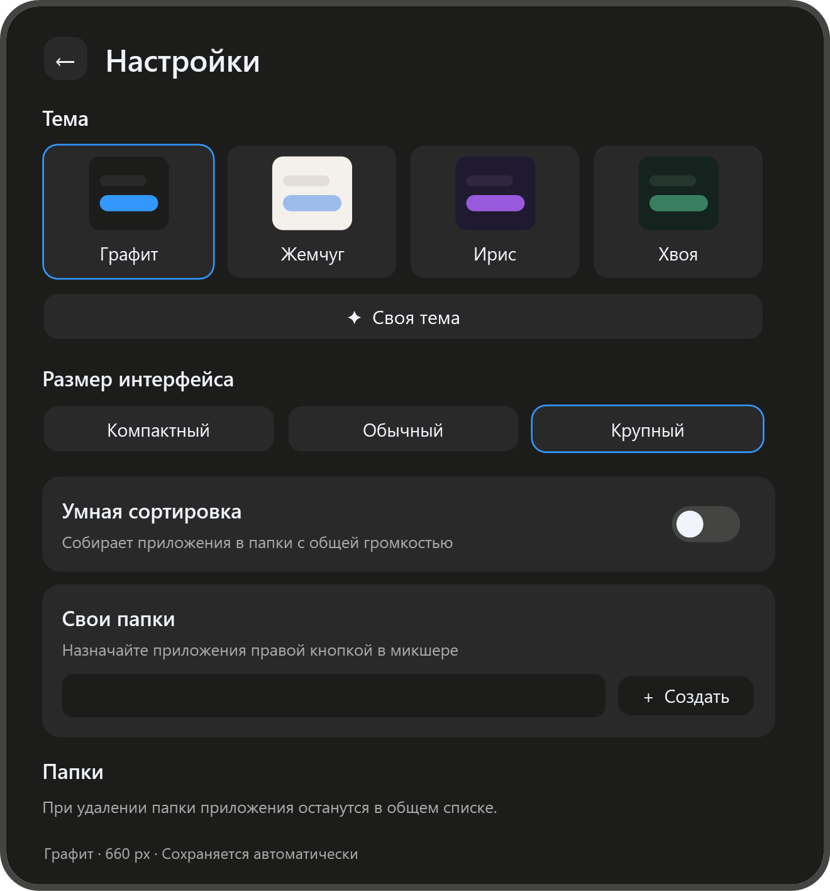
</div>

Тема, размер, порядок приложений и параметры групп сохраняются локально:

```text
%LOCALAPPDATA%\Veyro\settings.json
```

## Полезно знать

**Приложения нет в списке?**  
Запусти в нём звук: список зависит от аудиосессий Windows. Также проверь выбранное устройство вывода.

**Хочется расставить приложения вручную?**  
Удерживай строку приложения и перетащи её. Во время перетаскивания список можно прокручивать колёсиком мыши.

**Не нужна автоматическая группировка?**  
Отключи умную сортировку в настройках и организуй приложения самостоятельно.

**Нужен ли интернет для регулировки звука?**  
Нет. Микшер работает с аудиоустройствами и сессиями Windows локально.

---

<div align="center">

**Veyro by Fengible**  
Сделай звук своим.

</div>

## Open source / Открытый код

Veyro is open source under the [MIT license](LICENSE). The repository includes
the audio mixer, custom installer and uninstaller. Third-party dependencies
retain their own licenses; see [third-party notices](THIRD-PARTY-NOTICES.md).

### Build from source

Requirements: Windows 10/11 x64, .NET 8 SDK and PowerShell with Compress-Archive.
From the repository root:

```powershell
./installer/build.ps1
```

This builds `publish/Veyro.exe`,
`installer/uninstaller-publish/Uninstall-Veyro.exe`, and `dist/Veyro-Setup.exe`.
The installer payload is generated locally from the app and uninstaller; no
prebuilt payload is required. Building does not install or launch the app.

GitHub Actions performs the same build on a Windows runner. Download the
`Veyro-windows-x64-unsigned` artifact from a successful workflow run. These builds
are unsigned and may display SmartScreen warnings. Published user downloads are
available on the [Releases page](https://github.com/officialFengi/Veyro/releases).

### Code signing policy

See [Code signing policy](docs/CODE_SIGNING.md) for maintainer roles, privacy and
release requirements. A SignPath application was submitted on 2026-11-17; signing has not
yet been approved or enabled.

### Contributing

Describe bugs with your Windows version, Veyro version and reproduction steps.
Keep private information out of screenshots and logs. Submit focused pull
requests; contributions are reviewed by the maintainer and licensed under MIT.
